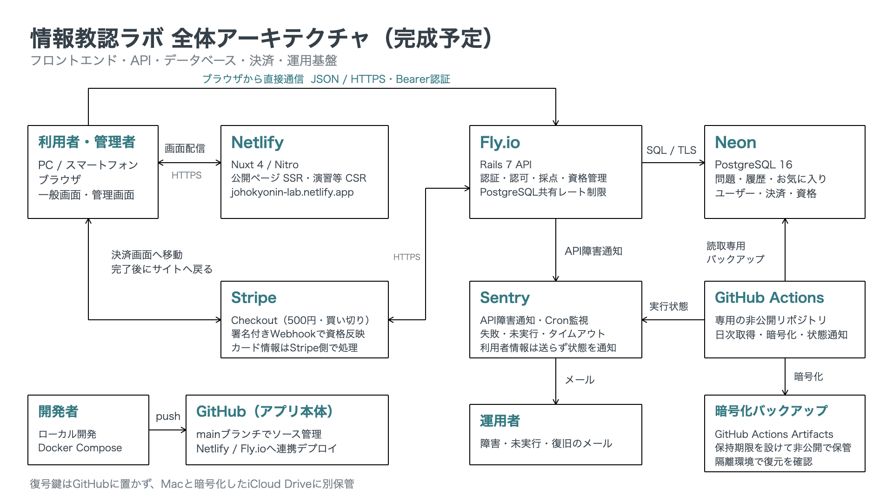

# 概要
「高等学校（情報）教員資格認定試験」の問題演習サイト   
※TQCE：教員資格認定試験 Teacher Qualification Certification Exam の略（非公式）   
本試験は令和6年度から始まった試験であり、演習サイトなどあるわけもなく、そもそも過去問自体が少ないという課題がある。   
そこで、過去問や指導要領等の原典をベースとして生成AIに問題を作成させ、多くの問題を解ける仕組みを作るべく開発に至った。

## 技術構成

- フロントエンド: Nuxt 4
- バックエンド: Ruby on Rails 7 API
- データベース: PostgreSQL 16
- 開発環境: Docker Compose

## 全体アーキテクチャ（完成予定）

公開・運用準備完了時の構成を示します。現在の本番反映状況や残件は [公開前運用確認](document/公開前運用確認_2026-10-20.md) を参照してください。



## 開発環境の起動

このプロジェクトは Nuxt、Rails API、PostgreSQL を Docker Compose で起動する構成です。
ローカルブラウザで http://localhost:3000 を開くには、Docker Desktop を起動したうえでコンテナを立ち上げておく必要があります。

通常は、プロジェクトルートから以下を実行します。

```sh
docker compose up
```

初回起動時、または Dockerfile、Gemfile、package.json を変更した後は、以下を実行します。

```sh
docker compose up --build
```

起動後、以下の URL にアクセスできます。

- Frontend: http://localhost:3000
- Backend health check: http://localhost:3001/api/v1/health
- Admin login: http://localhost:3000/admin/login
- Admin questions: http://localhost:3000/admin/questions

管理画面は `role = admin` のユーザーのみ利用できます。一般画面で管理者としてログイン済みの場合は、同じ認証セッションを使って管理画面へ遷移できます。

Docker Composeでは、Nuxtのサーバー側認証確認に `NUXT_API_BASE_INTERNAL=http://backend:3000` を使用します。ブラウザは従来どおり `NUXT_PUBLIC_API_BASE` を使用します。内部URLは非公開のruntime configで扱い、本番で未設定の場合は公開APIのURLへ接続します。Composeの設定変更後は `docker compose up -d frontend` でコンテナを再作成してください。Railsの開発用Host許可には `backend` のみ追加しています。

## Stripe有料会員の設定

有料会員は500円（税込）の買い切りです。模擬試験1〜5は無料、模擬試験6以降は有効な有料会員または管理者だけが利用できます。販売開始フラグの初期値は `false` です。

1. Stripeで「模擬試験6以降の利用資格（買い切り）」など提供内容が分かる名称のProductと、日本円500円の一回払い用Priceを作成します。Stripe Dashboardの公開情報には、サイトURL `https://johokyonin-lab.netlify.app/`、利用規約URL `https://johokyonin-lab.netlify.app/terms`、プライバシーポリシーURL `https://johokyonin-lab.netlify.app/privacy-policy` を登録します。Checkoutでは利用規約への同意を必須にするため、URL未設定時はSessionを作成できません。ドメインを変更してもDashboardの登録値は自動更新されないため、販売前に確認してください。
2. StripeのWebhook送信先を `https://<backend-host>/api/v1/webhooks/stripe` とし、次のイベントを登録します。
   - `checkout.session.completed`
   - `checkout.session.expired`
   - `refund.created`
   - `refund.updated`
   - `refund.failed`
   - `charge.dispute.created`
   - `charge.dispute.closed`
3. `.env.example` に記載したStripe設定、フロントエンドURL、販売事業者情報を設定します。シークレット値はリポジトリへ保存しません。
4. Stripeのテストモードで、購入、Webhook再送、全額返金、異議申立て、重複購入防止を確認します。
5. 利用規約、プライバシーポリシー、特定商取引法に基づく表記の実情報を確認した後、`PAID_MEMBERSHIP_ENABLED=true` にします。

販売事業者情報には、実際の氏名または登記上の名称、現に活動する正確な住所、確実に連絡できる電話番号及び問い合わせ先を設定してください。サイト名や未登記の屋号だけを販売事業者名として使用しないでください。

ローカルでは `STRIPE_LIVEMODE=false` を使用します。本番では本番用のキー、Price、Webhook署名シークレットにそろえて `STRIPE_LIVEMODE=true` とし、テスト環境の値と混在させないでください。カード番号等はStripe Checkoutが取り扱い、本アプリのDBには保存しません。

## 本番確認用の期限付き資格

販売開始条件、読み取り専用の運用点検、バックアップ・隔離復元、Webhook再送、監視・障害時の手順は [運用手順](document/運用手順.md) を参照してください。`bin/rails operations:audit` は設定不足の項目名と決済の集計だけを出し、DBやStripeを変更しません。手順やテストの準備と、本番の定期実行・通知・復元確認は区別します。

バックアップの実装と詳細な運用記録は専用の非公開リポジトリで管理します。暗号化保管・隔離復元と整合性確認、日次用の手動実行と通知を確認済みです。定期起動の継続、試用終了後の無料プランでの継続、復旧目標の確認は残っています。[資料の管理方針](operations/README.md) と [確認結果・残件](document/公開前運用確認_2026-10-20.md) を参照してください。

購入済みの有料会員資格と区別するため、運用確認には `verification_access_grants` を使います。決済記録やStripe IDを作らず、最長7日で失効します。アカウント画面には検証用であることと期限を表示し、一般会員を管理者へ昇格させません。販売開始フラグやStripe設定は変更しません。

対象と付与理由を確認して、バックエンドで次を実行します。既存の資格は上書きしません。日時・メールアドレス・運用者は実行時に対象へ置き換え、パスワードをコマンド引数やログへ記載しないでください。

```sh
USER_EMAIL='<確認用ユーザー>' REASON='Netlify移行の承認済み動作確認' GRANTED_BY='<承認した運用者>' EXPIRES_AT='<付与から7日以内のISO 8601日時>' bin/rails verification_access:grant
USER_EMAIL='<確認用ユーザー>' bin/rails verification_access:revoke
```

期限切れ・取消後は同じログイントークンでも有料問題・お気に入りAPIを拒否します。履歴・お気に入りは削除しません。付与・取消用の公開APIはありません。これは購入・Webhook・返金の実決済試験の代わりにはなりません。

## 公開前のアクセス制限

一般利用者の閲覧制限にはNetlifyのProject visibilityを `Private` にして使用します。フロントエンドのBasic認証は廃止し、ローカルでもBasic認証の入力は不要です。会員ログイン、管理者権限、有料コンテンツの利用資格の確認は別の仕組みとして維持します。NetlifyのPrivate設定はFly.ioのAPIを保護しないため、API側の認証・認可も維持します。

この変更をデプロイする前に、本番・プレビュー・各デプロイURLがPrivateの対象であることを確認してください。旧Vercelなど他の配信先ではNetlifyのPrivate設定は適用されません。旧環境の自動デプロイを止め、Basic認証が残る最後の成功デプロイを切戻し用に保持し、保護のない新コードを旧環境へ配信しないでください。NetlifyをPublicへ切り替える判断は別途行います。

HTTP確認、ユーザーの目視確認、エージェントの実操作確認は区別して記録します。

## Nuxtのレンダリング方針

`frontend/nuxt.config.ts` の `routeRules` で、ページの性質に応じてレンダリング方式を分けます。

- トップ、試験概要、利用規約、プライバシーポリシーなどの公開ページはSSRし、初期HTMLに本文とSEOメタ情報を含めます。
- 問題演習、解答履歴、お気に入り、アカウント、決済結果確認、管理画面はユーザー固有データを扱うためCSRにします。これらのルートには `noindex, nofollow` も設定します。
- 有料会員案内と特定商取引法に基づく表記は公開本文をSSRし、販売状態や販売者情報だけをクライアントからRails APIで確認します。

Basic認証の廃止によってレンダリング方式やキャッシュ方針は変更しません。公開ページのSSRとユーザー固有画面のCSR・noindexを維持し、SSG/prerenderへの変更はこの作業には含めません。

共通レイアウトはRailsの `/api/v1/health` と `/api/v1/exams` を呼びません。試験サイドバーは `frontend/app/utils/examCatalog.ts` の固定カタログを使い、未ログインユーザー及び無料会員には模擬試験1〜5、有料会員及び管理者には全公開分を表示します。問題の公開・非公開を変更するときは、固定カタログの試験番号と問番号も同じ変更内で更新してください。

未ログインでトップページなどの静的な内容を見るだけならRails APIへ接続しません。ログイン状態のCookieがある場合だけ、初回表示時に `/api/v1/me` を1回呼んで有料会員資格を確認します。フッターはAPIをまだ利用していない間は「API接続は利用時に確認」と表示します。問題取得、回答、履歴、決済など必要な操作では従来どおりRails APIを使用し、有料コンテンツの認可もRails側で行います。

お気に入りは有料会員と管理者向けです。サイドバーの黄色表示には、既存のログイン・ユーザー情報レスポンスに含まれる `favorite_questions`（公開中の問題ID・模試番号・問番号のみ）を使います。開閉・ページ移動や登録解除後の確認用通信は追加せず、共有状態を更新します。無料会員には空配列を返し、既存データは削除せず保持します。別端末で変更した状態は再読み込み・再ログイン時に同期します。

## フロントエンドのデプロイ（Netlify）

フロントエンドはNetlify、バックエンドはFly.io、DBはNeonを使用します。現在のフロントエンドURLは https://johokyonin-lab.netlify.app/ です（2026年10月20日にNetlifyのサイト名を変更）。ビルド・デプロイの成功報告と、実際の画面・API疎通の完了は区別します。移行時の確認状況とドメイン変更・切替・切戻しの手順は [Netlify移行確認記録](document/Netlify移行確認_2026-10-19.md) を参照してください。

| 設定 | 値 |
| --- | --- |
| デプロイ対象ブランチ | `main` |
| Base directory | `frontend` |
| Build command | `npm run build` |
| Publish directory | `dist`（Base directoryからの相対パス） |
| Functions directory | 初期値の `netlify/functions` から変更不要。Nuxt/Nitroが必要なFunctionsを自動生成する |
| Node.js | `NODE_VERSION=22`（ローカルDockerと同じメジャーバージョン） |

Netlifyの管理画面で次の環境変数を設定します。`NUXT_PUBLIC_API_BASE` はBuildsとFunctionsの両方のスコープで利用できるようにし、秘密値をIssue・ログ・リポジトリへ保存しません。

| 変数 | 設定内容 |
| --- | --- |
| `NUXT_PUBLIC_API_BASE` | `https://tqce-info-practice.fly.dev`（`/api/v1`は付けない） |

Docker用の `NUXT_API_BASE_INTERNAL=http://backend:3000` はNetlifyへ設定しません。DB接続情報・Stripeの秘密鍵もNetlifyへ移さず、Fly.io側で管理します。フロントエンドでは `NUXT_BASIC_AUTH_USER` / `NUXT_BASIC_AUTH_PASSWORD` を使用しないため、Netlifyでは不要です。既存のローカル `.env` やFly.ioの設定は、バックエンドの互換用設定として利用される場合があるため、この変更では削除しません。

2026年10月20日に、ユーザーからNetlifyの旧Basic認証2変数を削除したとの報告を受け、`SECRETS_SCAN_OMIT_KEYS` と、その設定だけを持っていた `frontend/netlify.toml` を撤去しました。リポジトリ側で秘密情報の検査を除外する設定は設けません。Netlifyのビルド設定は管理画面の設定を維持します。

公開前はNetlifyのPrivate設定によるログイン制限を維持します。閲覧できるNetlifyアカウントで画面を確認し、動作確認のためだけにPublicへ変更しません。

Railsの本番 `CORS_ORIGINS` は `https://johokyonin-lab.netlify.app` のみにします。開発環境だけがlocalhost/127.0.0.1:3000を既定で許可し、本番では開発用URLやVercelの正規表現を自動許可しません。本番の追加オリジンはHTTPSの完全一致で、パス・認証情報・末尾の `/` を付けずカンマ区切りにします。未設定ならクロスオリジンを許可せず、不正値は起動時に拒否します。プレビューが必要な場合も対象URLを個別に追加し、検証後に削除します。

CORSはブラウザ向けの制御で、APIへの直接アクセスを防ぐ認証ではありません。既存のBearer認証・管理者及び有料資格の検査は維持します。実際の反映・拒否確認は[公開前運用確認](document/公開前運用確認_2026-10-20.md)に記録します。

`Cannot find module @rollup/rollup-linux-x64-gnu` などでインストールが失敗した場合は、成功時のNode/npm・インストール設定・キャッシュ条件とlockfileを照合します。ビルド前に失敗している場合、ビルドコマンドへの `npm install` の追加だけでは対処できません。成功時の対処が未確認のまま、lockfileの全再生成や依存バージョンの更新を実施しないでください。

## 停止

```sh
docker compose down
```

データベースの内容も削除したい場合は、以下を実行します。

```sh
docker compose down -v
```

## バックエンドのデプロイ

バックエンドは Fly.io にデプロイします。Fly.io の設定は `backend/fly.toml` に置いています。

初回は Fly.io にログインしたうえで、バックエンドディレクトリからアプリを作成します。

```sh
cd backend
fly launch --no-deploy
```

`backend/fly.toml` の `app` 名と Fly.io 側のアプリ名が異なる場合は、どちらかに合わせてください。

本番で必要な環境変数は Fly.io の secrets に設定します。DB は Neon を使う想定です。

```sh
fly secrets set SECRET_KEY_BASE=<secret>
fly secrets set DATABASE_URL=<neon-production-database-url>
fly secrets set CORS_ORIGINS=https://johokyonin-lab.netlify.app
```

有料会員を販売する場合は、Stripeと公開事業者情報もFly.ioのsecretsへ設定します。実値はコマンド履歴や共有ログへ残さない方法で設定してください。

```sh
fly secrets set PAID_MEMBERSHIP_ENABLED=true
fly secrets set STRIPE_LIVEMODE=true
fly secrets set STRIPE_SECRET_KEY=<stripe-secret-key>
fly secrets set STRIPE_WEBHOOK_SECRET=<stripe-webhook-secret>
fly secrets set STRIPE_PRICE_ID=<stripe-price-id>
fly secrets set FRONTEND_URL=https://johokyonin-lab.netlify.app
```

`NUXT_PUBLIC_SELLER_NAME`、`NUXT_PUBLIC_SELLER_REPRESENTATIVE`、`NUXT_PUBLIC_SELLER_ADDRESS`、`NUXT_PUBLIC_SELLER_PHONE`、`NUXT_PUBLIC_SELLER_EMAIL` はFly.ioへ実情報を設定します。これらは秘密情報ではなく、公開販売設定APIを通じて特定商取引法に基づく表記へ表示されます。

バックエンドのルート画面に Basic 認証をかける場合は、以下も設定します。

```sh
fly secrets set BACKEND_BASIC_AUTH_USER=<user>
fly secrets set BACKEND_BASIC_AUTH_PASSWORD=<password>
```

デプロイは以下で実行します。

```sh
fly deploy
```

2026年10月21日の問題完成扱い・seed廃止の承認により、実行用の問題seedを廃止しました。`backend/fly.toml` の `release_command` はDBの準備だけを行います。

```sh
bin/rails db:prepare
```

通常のデプロイやpushでは問題を投入・同期しません。既存DBを正本として管理画面で作成・編集します。`db/seeds.rb` は何もしない入口だけを残しており、未初期化DBの `db:prepare` や手動の `db:seed` からも問題は追加されません。新規環境への投入は、管理画面又は明示的な問題アーカイブ取込みで行います。

`release_command` が失敗した場合は新しいリリースへ切り替わりません。以前のseed投入のために延長した `release_command_timeout = '15m'` は、DB準備の上限として維持します。待機時間を使い切るのが正常という意味ではなく、問題1,000問の再同期は行いません。

管理画面の保存は `QuestionWriter` を通し、問題文・選択肢・正答・解説・出典・分類・問題番号の変更時には、その問題の古い回答履歴を同じトランザクション内で削除します。公開状態だけの変更では履歴を残します。通常の改稿で問題ID・選択肢ID・お気に入りを作り直しません。

作成途中の模擬試験は、承認済みの問題だけを `draft`（下書き）で登録します。下書きは管理画面で確認できますが、一般向けの模擬試験一覧や問題取得APIには表示されません。全20問がそろい、セット全体の検証が完了した後に公開へ切り替えます。

### DB正本の問題運用

- 本番DBの問題を正本とします。管理者認可、4択・正答1件、公開時の本文・出典・空欄・20問登録検査は維持します。削除した問題はデプロイで復活しません。
- seed管理による番号変更制限と削除記録を撤去しました。管理APIでは通常の範囲・重複・公開時検査を満たせば番号を変更できます。公開対象の構成を変える際は `frontend/app/utils/examCatalog.ts` と表示資料も確認してください。
- `QuestionSeedSync`、`QuestionSeedState` 及び承認済みの旧50セットはテスト専用に移し、実行用seedから外しました。`backend/test/fixtures/approved_question_catalog/` は凍結した回帰検査資料であり、現在のDBや新規問題の編集元ではありません。原典fixture・承認記録・固定ハッシュは保持します。本番イメージには `test/` を同梱しません。
- `question_seed_states` は旧版とのローリング更新互換性のため、未使用の履歴表として残します。旧版の稼働・切戻し期間が終わる前に削除せず、物理削除は別途承認後のマイグレーションで行います。
- 問題だけの書き出し・空DBへの取込みは [運用手順](document/運用手順.md#問題データの編集と新規環境への移送) を参照してください。既存DBへの上書き同期は提供しません。ユーザー・履歴・お気に入り等を含む完全バックアップと混同しないでください。
- 本番の最終内容照合、既存の暗号化バックアップの有効性確認、デプロイ結果確認は切替前後に別途行います。このコード変更だけでは本番切替済みとは扱いません。

デプロイ後、Netlify側の `NUXT_PUBLIC_API_BASE` にはFly.ioのバックエンドURLを設定します。

```text
https://tqce-info-practice.fly.dev
```

### release_command が失敗する場合

`release_command failed` は、処理の異常終了だけでなく、完了待ちのタイムアウトでも発生します。まず該当リリース用マシンのログで、起動時刻、終了時刻、終了コードを確認してください。マシンIDが分かる場合は、そのマシンに絞ってログを取得できます。

```sh
fly logs -a tqce-info-practice --machine <machine-id> --no-tail
```

待ち時間を超えた後に終了コード0が記録されている場合は、デプロイが失敗扱いでもDB準備が完了している可能性があります。アプリのデプロイ結果とDBの状態は別に確認してください。先の処理が実行中のまま、別のデプロイを重ねないでください。

処理時間超過には `release_command_timeout` を使用します。まだ時間が足りない場合は、DB接続・ロック待ちやマイグレーションの所要時間も調べ、無制限に待つ設定や検証の省略で回避しないでください。再デプロイ時に `--release-command-timeout` が明示されている場合は、その値も確認してください。seed廃止後の通常デプロイで問題投入処理を追加し直さないでください。

認証情報の未設定やDB接続エラーが記録されている場合は、以下で必要なsecretsの名前が存在するか確認します。値や接続文字列をログへ出力しないでください。

```sh
fly secrets list -a tqce-info-practice
```

ログの詳細は以下で確認します。

```sh
fly logs -a tqce-info-practice
```

DB が Neon の場合、`DATABASE_URL` は本番用の接続文字列を設定します。接続文字列のパスワードやクエリ文字列にシェル特殊文字が含まれる場合は、値全体をシングルクォートで囲んで設定してください。

```sh
fly secrets set DATABASE_URL='<neon-production-database-url>' -a tqce-info-practice
```

## ディレクトリ構成

```text
.
├── frontend/   # Nuxt 4 app
│   ├── app/    # Nuxt 4 のアプリケーションコード
│   └── nuxt.config.ts
├── backend/    # Rails API
└── docker-compose.yml
```
