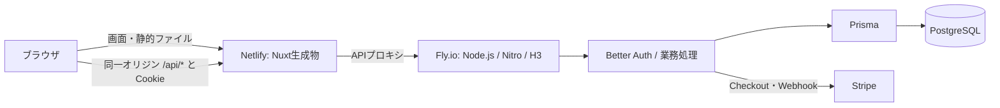

# 概要
「高等学校（情報）教員資格認定試験」の問題演習サイト   
※TQCE：教員資格認定試験 Teacher Qualification Certification Exam の略（非公式）   
本試験は令和6年度から始まった試験であり、演習サイトなどあるわけもなく、そもそも過去問自体が少ないという課題がある。   
そこで、過去問や指導要領等の原典をベースとして生成AIに問題を作成させ、多くの問題を解ける仕組みを作るべく開発に至った。

## 技術構成

Nuxt 4の画面とNitro/H3のAPIをTypeScriptで実装します。DB操作・認証・マイグレーションはライブラリへ委ねます。

| ライブラリ・基盤 | 用途 |
| --- | --- |
| Nuxt 4 / Vue 3 | ページ、ルーティング、表示更新 |
| Nitro / H3 | Node.js上のAPI、HTTP処理、ファイルベースのAPIルーティング |
| TypeScript | 画面・サーバー・共通型 |
| Nuxt UI / Tailwind CSS / Lucide | フォーム、入力エラー、スタイル、アイコン |
| Zod | フロントエンドとAPIで共有する入力・問題・設定の検証 |
| Prisma / `@prisma/adapter-pg` / `pg` | PostgreSQLへのDB操作 |
| Prisma Migrate | バージョン管理したスキーマ変更 |
| Better Auth | パスワードハッシュ、Cookieセッション、登録・ログイン・ログアウト |
| rate-limiter-flexible | PostgreSQLで共有する操作回数制限。認証の入口はBetter Auth標準機能 |
| Stripe公式SDK | Checkoutと署名付きWebhook |
| Sentry公式Node SDK | 許可した固定項目だけのAPI障害通知。初期状態は送信無効 |
| Node.js組込みテスト / Playwright | 単体・API・ブラウザ操作の検証 |
| PostgreSQL 16（ローカル）/ Neon PostgreSQL 18（本番）/ Docker Compose | DBと開発環境 |

正確なバージョンは `frontend/package-lock.json`、依存一覧は `frontend/package.json` を参照してください。`backend/` のRailsコードは旧構成の参照・切戻し資料として残しており、通常の起動・ビルド・デプロイでは使用しません。

## アーキテクチャ



Netlifyは公開ページのHTMLとJavaScriptをビルド時に生成して配信します。動的な演習・履歴・管理画面はブラウザで描画し、`/api/*` は既存Fly.io APIへ転送します。認証CookieはNetlifyのオリジンに保存され、JavaScriptから読み出しません。Fly.ioは `NUXT_API_ONLY=true` によりAPI以外を404にし、NetlifyのPrivateを迂回する画面配信を行いません。

DB認可は各APIで現在のユーザー・権限・有料資格を確認します。無料範囲・50セット×20問・分類・500円の料金は `config/exam.json` が正本です。画面名や最新の「利用にあたって」、問題と選択肢の内容は移行で変更しません。

旧Rails構成の画像は [旧アーキテクチャ図](document/images/architecture.jpeg) として保存しています。移行時のデータ保全と検証・反映結果は [テンプレート移行記録](document/テンプレート移行_2026-10-24.md)、過去の公開準備の実施記録は [公開前運用確認](document/公開前運用確認_2026-10-20.md) を参照してください。

## 開発環境

Node.js 24とDocker Composeを使用します。`.env.example` を参考に、Git管理外の `.env` へDBパスワードと64文字以上の独立したランダムな `BETTER_AUTH_SECRET` を設定します。既存 `.env` の値は一括上書きしません。認証情報をコマンド引数・ログ・Issueへ記載しないでください。

```sh
docker compose up -d --build
```

- 画面・API: http://localhost:3000
- API確認用の同一サービス別ポート: http://localhost:3001/api/v1/health
- 管理ログイン: http://localhost:3000/admin/login
- 新DB: localhost:5433 / `tqce_nuxt_development`

Nuxtの画面とAPIは同じサービスで起動します。Composeは旧Railsの `DATABASE_URL` を引き継がず、新しい `nuxt-db` と `nuxt_postgres_data` を使用します。旧DBは `legacy` profileと元の `postgres_data` volumeに残します。新DBへの問題取込みと管理者作成は明示操作です。起動・マイグレーション・`db:seed` では問題を投入しません。

停止は `docker compose down` です。データ保全のため移行中に `down -v` やvolume削除を実行しないでください。PC負荷を抑えるため、テスト・型検査・ビルドを同時実行せず、コンテナのCPU・メモリを制限して順番に実行します。

## 開発時の確認

`frontend/` で実行します。サーバーテスト・E2Eには通常環境と分離したテストDBを使用してください。

```sh
npm test
npm run test:server
npm run typecheck
npm run test:e2e
npm run db:validate
```

`node scripts/check-template.mjs` はリポジトリルートから設定と合成fixtureを検査します。`content/questions.json` の40問は自動テスト用の架空データであり、本番問題の編集元ではありません。E2E専用の無料設定は `APP_ENV=test` と `TQCE_E2E_FREE_MODE=true` が両方そろう場合だけ有効となり、本番では有効になりません。

## 認証・DB運用

Better Authの `/api/auth/sign-up/email`、`sign-in/email`、`sign-out`、`get-session` を使用します。セッション期限は24時間、CookieはHttpOnly・SameSite=Lax、本番はSecure、Domain指定なしです。一般画面・管理画面は同じセッションを共有します。旧Bearerトークンは使用しません。

Prismaスキーマは `frontend/prisma/schema.prisma`、適用履歴は `frontend/prisma/migrations/` です。DB変更はマイグレーションとして追加し、適用済みファイルを編集しません。

```sh
docker compose exec -T frontend npm run db:migrate
```

管理者は `ADMIN_EMAIL`、`ADMIN_PASSWORD`、`ADMIN_NAME` を実行環境へ安全に渡して `npm run admin:create` で作成します。既存ユーザーの権限やパスワードは上書きしません。購入資格とは独立した最長7日の検証用資格は `npm run operations -- verification_access:grant` / `verification_access:revoke`、読み取り専用点検は `npm run operations -- operations:audit` です。各コマンドの変数と移送手順は [運用手順](document/運用手順.md) を参照してください。

今回の切替では問題・選択肢のID・内容・正答・公開状態・日時を保全し、ユーザー・履歴等は移行しない方針が承認されています。通常運用でのユーザー削除や問題の再作成を許可するルールではありません。完全バックアップと問題だけのアーカイブを区別してください。

## Stripeプレミアム会員の設定

プレミアム会員は500円（税込）の買い切りです。模擬試験1〜5は無料、模擬試験6以降は有効なプレミアム会員または管理者だけが利用できます。販売開始フラグの初期値は `false` です。

1. Stripeで「模擬試験6以降の利用資格（買い切り）」など提供内容が分かる名称のProductと、日本円500円の一回払い用Priceを作成します。Stripe Dashboardの公開情報には、サイトURL `https://johokyonin-lab.netlify.app/`、利用規約URL `https://johokyonin-lab.netlify.app/terms`、プライバシーポリシーURL `https://johokyonin-lab.netlify.app/privacy-policy` を登録します。Checkoutでは利用規約への同意を必須にするため、URL未設定時はSessionを作成できません。ドメインを変更してもDashboardの登録値は自動更新されないため、販売前に確認してください。
2. StripeのWebhook送信先を `https://<backend-host>/api/v1/webhooks/stripe` とし、次のイベントを登録します。
   - `checkout.session.completed`
   - `checkout.session.expired`
   - `refund.created`
   - `refund.updated`
   - `refund.failed`
   - `charge.dispute.created`
   - `charge.dispute.closed`
3. `.env.example` に記載したStripe設定、フロントエンドURL、販売事業者情報を設定します。シークレット値はリポジトリへ保存しません。
4. Stripeのテストモードで、購入、Webhook再送、全額返金、異議申立て、重複購入防止を確認します。
5. 利用規約、プライバシーポリシー、特定商取引法に基づく表記の実情報を確認した後、`PAID_MEMBERSHIP_ENABLED=true` にします。

販売事業者情報には、実際の氏名または登記上の名称と問い合わせ先を設定してください。サイト名や未登記の屋号だけを販売事業者名として使用しないでください。住所・電話番号を公開する初期方式は `SELLER_CONTACT_DISCLOSURE_MODE=public` で、実際の住所・電話番号も必須です。

個人情報保護のため請求時の開示方式を採用する場合は、`SELLER_CONTACT_DISCLOSURE_MODE=on_request` とします。この方式では住所・電話番号の公開用環境変数は不要で、既存の値が残っていても公開APIは空文字列を返します。購入前の請求にも十分な時間的余裕をもって、実情報を遅滞なく無料でメール回答できる体制を確認した後にだけ `SELLER_CONTACT_DISCLOSURE_READY=true` とします。文言を掲載するだけでは条件を満たしません。氏名・問い合わせ先は必須のままで、販売開始フラグも独立して無効を維持します。根拠と運用は [消費者庁の案内](https://www.no-trouble.caa.go.jp/what/mailorder/) と [運用手順](document/運用手順.md#所在地電話番号の請求時開示) を参照してください。

ローカルでは `STRIPE_LIVEMODE=false` を使用します。本番では本番用のキー、Price、Webhook署名シークレットにそろえて `STRIPE_LIVEMODE=true` とし、テスト環境の値と混在させないでください。カード番号等はStripe Checkoutが取り扱い、本アプリのDBには保存しません。

## 公開前のアクセス制限・通知

Netlifyの本番・プレビュー・各デプロイURLはPrivateを維持します。フロントエンドにBasic認証は設けません。Fly.io APIは別の公開口であるため、管理者・会員・有料資格の認可、Origin検査、JSON検査、操作回数制限を維持します。販売開始・Private解除・Sentry送信有効化は今回の移行に含めません。

Sentryは公式SDKを使用し、自動収集を無効にした独立クライアントへ固定した障害情報だけを渡します。利用者・リクエスト・例外本文・接続情報は送りません。`ERROR_NOTIFICATIONS_ENABLED=false` を初期値とし、既存のバックアップ通知とは区別します。

バックアップの実装と秘密情報を含む運用記録は専用の非公開リポジトリで管理します。[資料の管理方針](operations/README.md) と [運用手順](document/運用手順.md) を参照してください。新DBへ切り替える場合は、バックアップの接続先と権限も新DBについて確認します。

## 本番デプロイ

既存のURL・Netlifyプロジェクト・Fly.ioアプリを使用します。

| 配信先 | 設定 |
| --- | --- |
| Netlify | `frontend/netlify.toml`。Node.js 24、`NUXT_STATIC_FRONTEND=true NUXT_PUBLIC_API_BASE= npm run generate`、公開先 `.output/public` |
| Fly.io | ルート `fly.toml` と `frontend/Dockerfile`。Node/Nitro、API専用、release時 `npm run db:migrate` |
| PostgreSQL | Fly secretsの `DATABASE_URL`。Netlifyには渡さない |
| Better Auth | Fly secretsの `BETTER_AUTH_SECRET`。`BETTER_AUTH_URL` はNetlifyのHTTPSオリジン |

NetlifyのAPI転送先は `https://tqce-info-practice.fly.dev/api/:splat` です。ブラウザ側の `NUXT_PUBLIC_API_BASE` は空にし、絶対URLへの直接アクセスへ戻しません。DB接続情報、認証秘密鍵、Stripe秘密鍵はFly.ioで管理します。

ローカル検証・ビルド・データ照合とFly.io API切替を完了してから、最後のmainへのpushでNetlifyを1回だけ反映します。途中のプレビューや手動再ビルドを重ねません。反映後は配信コミット、Private、APIプロキシ、ログイン・演習・管理操作を確認します。

Fly.ioへのデプロイはリポジトリルートから行います。

```sh
fly deploy --config fly.toml
```

`backend/fly.toml` は旧Rails用です。新しいDB接続・秘密鍵は事前に安全な手段で設定し、旧DBの接続情報とバックアップは切戻し用に保管します。`release_command` 失敗時はDB状態とリリース状態を個別に確認し、実行中の処理へ別のデプロイを重ねません。スキーマ準備に問題の自動投入を追加しないでください。

## ディレクトリ構成

```text
.
├── config/exam.json       # 情報教認の名称・試験構成・分類・料金
├── content/               # 合成テストfixture。実問題の正本はDB
├── frontend/
│   ├── app/               # Nuxt/Vue画面
│   ├── server/            # Nitro API・業務処理・運用CLI
│   ├── shared/            # 共通型・Zod検証
│   ├── prisma/            # Prismaスキーマとマイグレーション
│   ├── server-tests/      # 隔離DBでのサーバーテスト
│   └── e2e/               # Playwrightブラウザテスト
├── backend/               # 旧Rails構成の参照・切戻し資料
├── document/              # 仕様・作問資料・運用記録
├── operations/            # 公開可能な運用案内。private/はGit管理外
├── fly.toml               # Node/Nitro APIの本番構成
└── docker-compose.yml
```
